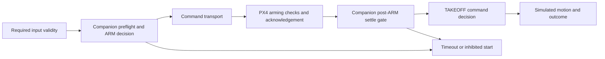
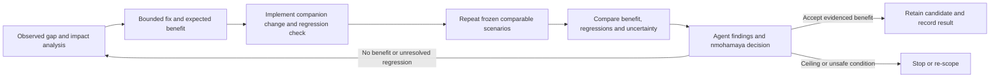

# Readiness pilot charter

| Field | Value |
|---|---|
| Status | Draft for nmohamaya review; not an accepted baseline or release |
| Date | 2026-11-12 |
| Coordination | [Platform P1 #7](https://github.com/nmohamaya/systems-engineering-platform/issues/7), [companion #830](https://github.com/nmohamaya/companion_software_stack/issues/830) |
| Milestone | [Pilot project](https://github.com/nmohamaya/systems-engineering-platform/milestone/1) |
| Source candidate | `9344ea87be8db62ae578d49e3e79597ccc7baf26`; remote main observed 2026-11-12 |
| Confirmed by owner | Simulation-only pilot; specialist agent reviews plus nmohamaya review |

## Outcome and envelope

Demonstrate a defensible improvement in companion readiness/arming behaviour using a repeatable simulation campaign. A useful negative/inconclusive result remains visible; it is not relabelled success.

| In scope | Out of scope |
|---|---|
| Startup through preflight, ARM, post-ARM settle, TAKEOFF decision and preflight abort/recovery | Real hardware, bench/HIL operation, physical ARM/flight or deployment approval |
| Missing/stale/inconsistent inputs, restart/re-arm and selected FC-link/VIO fault cases | Full mission performance, PCB design or complete safety/standards qualification |
| Deterministic simulated fixtures and a Gazebo/PX4 SITL reproduction path, subject to host preflight | Assuming mock/simulator results establish real-world reliability |
| Source/configuration identity, one generated scope-labelled SBOM and hardware-gap table | Fabricated BOM/serial/calibration records or installed-device inventory |

Start with existing scenario 02 for cold-start reproduction; P2/P3 confirm its configuration/host suitability and controlled nominal/degraded variants. Scenarios 04/15/16 are reuse candidates, not a frozen campaign. No performance or fault-rate target is accepted in this charter.

The diagram separates decision, emission, acknowledgement and simulated behaviour; it is a scope map, not a verified state machine. P2 must specify valid abort/recovery actions per state. Existing timeout logic must not be interpreted as making DISARM safe in every physical state.

## Closed-loop execution

| Loop rule | Execution |
|---|---|
| Diagnose then act | Platform-guided analysis names affected requirements, hazards, interfaces and evidence; propose a falsifiable benefit before editing companion code/configuration. |
| Implement | Within the agreed simulation scope, the assistant can prepare focused companion PRs and run authorised checks; nmohamaya retains acceptance authority. No hardware/flight actions are implied. |
| Compare fairly | Keep the original reference baseline and frozen confirmatory protocol. Identify every candidate revision, changed input and attempt; log failures and regressions, not only successful runs. |
| Iterate deliberately | Revise the hypothesis/fix when benefit is absent; revert/reject unsupported candidates and preserve their evidence. Predeclare iteration/stopping and multiplicity handling in P3/P17; repeated candidate search cannot claim an unadjusted one-shot statistical result. |
| Close on evidence | Accept a bounded benefit only with the declared checks and remaining limitations. Human acceptance is separate from merging code; a timebox expiry can end with an inconclusive result. |
| Improve the platform too | Turn useful findings and missed impacts into reviewed fixtures/skill corrections. Version those changes; keep held-out evaluations separate from tuning and re-evaluate affected capabilities. |

Initially this loop uses human-reviewed platform artifacts and existing companion tools. It does not assume the future E5 skills or background runtime are already implemented.

## Existing anchors to inspect

| Anchor at the candidate SHA | Pilot use; not an evidence claim |
|---|---|
| [Safety plan and hazard log](../../SAFETY_ENGINEERING.md) | G1 command authority and G2 stale-data goals; seed requirements and controls. |
| [Mission state logic](../../../process4_mission_planner/include/planner/mission_state_tick.h) | ARM debounce, post-ARM settle, preflight timeout; verify fresh-message versus repeated-tick semantics in P2. |
| [Configuration](../../../config/default.json) and [planner wiring](../../../process4_mission_planner/src/main.cpp) | Determine actual enabled gates and overrides; defaults/comments alone are insufficient. |
| [Fault injector](../../../tools/fault_injector/main.cpp), [04](../../../config/scenarios/04_fc_link_loss.json), [15](../../../config/scenarios/15_fc_quick_recovery.json), [16](../../../config/scenarios/16_vio_failure.json) | Reuse existing degraded-input mechanisms. |
| [Scenario 02](../../../config/scenarios/02_obstacle_avoidance.json), [evidence helper](../../../deploy/lib_evidence.sh) | Reproduce startup and retain traces; validate oracle and detect temporary storage fallback. |
| Companion #740/#746/#778/#806 | Historical observations and open-work reconciliation, not current quantified baseline. |

## Roles and RASIC

Roles below describe this pilot, not certification competence. R = responsible, A = accountable, S = supporting, I = informed, C = consulted.

| Activity | nmohamaya | Author/coordinator assistant | Specialist review agents |
|---|---|---|---|
| Scope, budgets, protocol/baseline acceptance | A/R | S | C |
| Draft artifacts, trace sources, consolidate findings | A | R | C |
| Safety/control, measurement and evidence reviews | A/R for human review | S; cannot self-accept | R for advisory findings only |
| Execute future authorised simulation checks | A; execution scope confirmed per task | R when assigned | I; read-only reviewers |
| Accept remaining risk or next test level | A/R within actual authority | S | C |

No independent human reviewer has been named. Clean-clone CI reproduction and time-separated review supplement nmohamaya's review but are not organisational independence. If a selected obligation requires independent personnel or qualifications, obtain them or leave that acceptance unmet. Agent findings never approve a baseline or represent standards conformance.

## Baseline and evidence gates

| Gate | Rule |
|---|---|
| P1 close | Owner reviews this charter and accepts/changes the proposed outcome classification, appetites and stop rules below. |
| Source freeze | Candidate SHA is not the tested baseline. Record tested product and clean/dirty state; retain/hash any local patch and untracked execution inputs. Record instrumentation/oracle revisions, config/model hashes, build/environment and run protocol after calibration. |
| Moving main | Continue product development normally; compare the frozen source with new safety fixes. Explicitly retain with rationale or rebaseline and rerun affected observations; never mix revisions silently. |
| P6 entry | P16 validates command observations; P5 provisions durable retrievable storage; P17 validates oracle, logs RTF/host load, runs diagnostic trials and freezes P3's feasible protocol. |
| Measurement | Predeclare trial unit, thresholds, sample plan, uncertainty, exclusions and stopping; missing observations are unknown, not zero unsafe commands. Diagnostic data is separate from confirmatory data. |
| E5/P15 | Evaluate narrow skills against manual/historical controls and grouped holdout; threat-model/control review precedes read-only shadow execution. |

Storage destination and compute ceiling remain undecided, owned by P5 and P3/P17 respectively; neither is waived by accepting this charter. No simulations or baseline runs have been executed for P1.

## Proposals requiring owner disposition

| Decision | Proposed rule |
|---|---|
| What counts as improvement | Report product behaviour and simulator/harness capability separately. Harness-only remediation is enabling progress; if no product benefit can be demonstrated, return an infrastructure-only/inconclusive result and explicitly re-scope E4. |
| Effort ceilings | E1/E2/E3/E4/E5: 3/4/4/4/5 engineer-days respectively, with a day defined as 8 active human engineering hours. Agent elapsed time, tool waiting and compute are separate; these are review ceilings, not estimates or permission to spend. |
| Resource decision | P3 drafts compute/storage caps; approximately five P17 diagnostic runs inform cost and final protocol feasibility. Confirmatory work waits for accepted caps. |
| Stop/re-scope | On reaching an agreed ceiling, unreliable oracle, missing authority/durable evidence, unaddressed critical hazard or infeasible comparison: stop the affected experiment, preserve evidence and request an explicit continue/change/stop decision. |

## Completion and effort control

P1 is complete only after nmohamaya reviews the charter, dispositions material findings and confirms the proposed decisions. Link that disposition from platform #7; a merged document alone is not approval. Keep P1 open meanwhile.

[Effort log](effort-log.csv) starts this session. Record human active/review time, agent elapsed time, tool waiting and expected/found impacts separately; unmeasured periods remain unknown. P3 refines the measurement method before comparing manual and skill-assisted work. This log does not treat assistant wall time as manual human engineering time.
